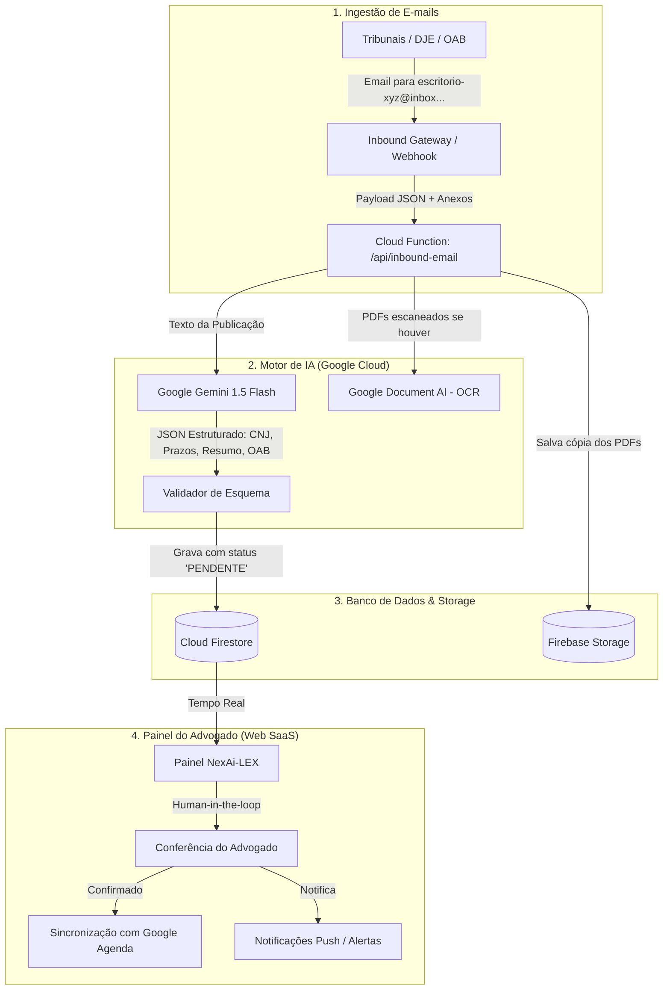

# NexAi-LEX — Plano Inicial de Desenvolvimento e Execução

Este documento estabelece o roadmap completo de desenvolvimento do **NexAi-LEX**, estruturado em fases de execução progressiva, utilizando 100% o ecossistema Google Cloud e Firebase.

---

## 1. Arquitetura Geral da Solução

---

## 2. Modelagem de Dados no Cloud Firestore

### 2.1 Coleção `tenants` (Escritórios / Workspaces)
* `id`: string (ex: `tenant_123`)
* `name`: string (ex: "Silva & Oliveira Advogados")
* `slug`: string (ex: "silva-oliveira")
* `inboundEmail`: string (ex: `silva-oliveira@inbox.nexai.com.br`)
* `plan`: `solo` | `office` | `pro`
* `maxUsers`: number (1 no solo, 3+ no office)
* `createdAt`: timestamp

### 2.2 Coleção `users` (Membros do Escritório)
* `id`: string (Firebase Auth UID)
* `tenantId`: string (referência ao tenant)
* `name`: string
* `email`: string
* `oabNumber`: string (ex: "123456/SP" — chave de roteamento automático)
* `role`: `ADMIN` | `LAWYER` | `ASSISTANT`
* `googleCalendarSync`: boolean

### 2.3 Coleção `cases` (Processos Judiciais)
* `id`: string (ex: `case_cnj_formatado`)
* `tenantId`: string
* `cnjNumber`: string (ex: "0001234-56.2024.8.26.0100")
* `court`: string (ex: "TJSP - 2ª Vara Cível da Capital")
* `clientName`: string
* `responsibleLawyerId`: string (atribuído automaticamente por OAB ou manual)
* `status`: `ACTIVE` | `ARCHIVED`
* `lastUpdate`: timestamp

### 2.4 Coleção `notifications_inbox` (Intimações Recebidas)
* `id`: string
* `tenantId`: string
* `caseId`: string (vinculado se já existir)
* `cnjNumber`: string
* `rawSubject`: string
* `rawBody`: string
* `extractedData`:
  * `lawyerOAB`: string
  * `court`: string
  * `intimationType`: string (Despacho, Sentença, Audiência, etc.)
  * `suggestedDeadlineDays`: number
  * `estimatedFatalDate`: timestamp
  * `summary`: string (resumo executivo do despacho em 2 parágrafos)
* `status`: `PENDING_REVIEW` | `APPROVED` | `REJECTED`
* `attachmentUrls`: string[]
* `receivedAt`: timestamp

---

## 3. Fases de Execução Imediata

### Fase 1: Fundação do Projeto & Arquitetura
1. Configuração do ambiente monorepo limpo:
   * `/functions`: Backend Serverless (Firebase Functions + Integração com Gemini API).
   * `/web`: Frontend SaaS Moderno para Advogados (Vite + React + TypeScript + CSS Design System premium).
2. Criação do arquivo de tipos compartilhados (`types.ts`).

### Fase 2: Motor de Extração Inteligente com Google Gemini
1. Prompt estruturado com `responseSchema` (JSON estrito) garantindo que o Gemini retorne exatamente os campos jurídicos sem alucinação.
2. Endpoint simulador de Webhook de e-mail para testes imediatos com publicações reais do DJE e tribunais.

### Fase 3: Interface SaaS do Advogado (Dashboard NexAi-LEX)
1. **Inbox de Intimações (Human-in-the-Loop):** Lista de e-mails processados com botões "Confirmar Prazo" e "Ajustar".
2. **Painel de Processos:** Visualização por processo e histórico cronológico.
3. **Agenda de Prazos:** Visão de calendário com prazos fatais e alertas.
4. **Simulador de E-mails ao Vivo:** Permite colar um e-mail de tribunal ou selecionar modelos reais para ver o sistema processando em tempo real.
